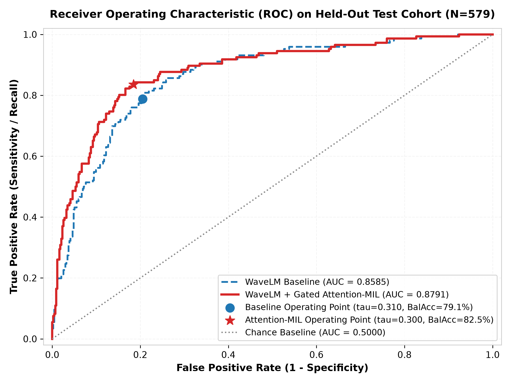
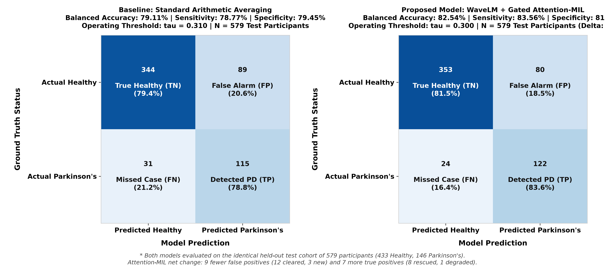

# NeuroVocal: Voice-Based Parkinson's Detection (Minor Project)

[](https://www.python.org/)
[](https://pytorch.org/)
[](https://huggingface.co/)
[](LICENSE)

A deep learning minor project for detecting Parkinson's Disease from sustained vowel audio recordings (`/aaa/`). Built on a fine-tuned **Microsoft WaveLM Base+** speech foundation model combined with **Gated Attention Multiple Instance Learning (Attention-MIL)** pooling. 

Evaluated with **100% strict participant-level separation** (zero participant overlap between training, validation, and test splits).

---

## Key Results (mPower Held-Out Test Set)

Evaluated on **579 unseen test participants** (146 Parkinson's, 433 Healthy Controls; 1,480 total audio recordings):

| Model Architecture | Pooling Method | Balanced Accuracy | Raw Accuracy | Sensitivity | Specificity | ROC-AUC | Optimal Cutoff ($\tau$) |
| :--- | :--- | :---: | :---: | :---: | :---: | :---: | :---: |
| **Wav2Vec 2.0 Base** | Arithmetic Mean | 74.72% | 73.06% | 78.08% | 71.36% | 0.8245 | 0.360 |
| **WaveLM Base+** | Arithmetic Mean (Baseline) | 79.11% | 79.27% | 78.77% | 79.45% | 0.8585 | 0.310 |
| **WaveLM Base+ (Proposed)** | **Gated Attention-MIL** | **`82.54%`** | **`82.04%`** | **`83.56%`** | **`81.52%`** | **`0.8791`** | **`0.300`** |

* **Held-Out Test Balanced Accuracy**: **`82.54%`** (95% Bootstrap CI: `[79.0%, 86.1%]`, Operating Cutoff $\tau = 0.300$, Recording Cutoff $\tau_{\text{rec}} = 0.310$)
* **Parkinson's Detection Sensitivity**: **`83.56%`** (122 / 146 PD participants correctly detected)
* **Healthy Control Specificity**: **`81.52%`** (353 / 433 healthy controls correctly cleared)
* **Test ROC-AUC**: **`0.8791`** (95% CI: `[0.845, 0.912]`)
* **Single Model Efficiency**: Fine-tuned WaveLM Base+ (~90M backbone parameters, frozen during MIL inference). Informal timing on the local GTX 1650 was roughly 1–2 s per recording; the repository does not include a formal latency benchmark.

---

## Evaluation Figures

### 1. ROC Curve
Shows model discrimination on the 579 test participants. WaveLM + Gated Attention-MIL operates at **83.56% Sensitivity** and **81.52% Specificity** ($\tau = 0.300$, AUC = 0.8791).



---

### 2. Confusion Matrices (Baseline vs. Proposed Model)
Side-by-side comparison evaluated on the identical held-out test cohort of 579 participants (433 Healthy, 146 Parkinson's):



* **Cleared False Alarms**: Attention-MIL reduced false positives from 89 to 80 (net **−9**: 12 controls cleared, 3 new false positives).
* **Rescued True Positives**: Correctly identified 122 of 146 Parkinson's patients (up from 115; net **+7**: 8 patients rescued, 1 previously correct patient degraded).
* **Balanced Accuracy Gain**: Improved test balanced accuracy from **79.11% to 82.54%** (+3.44% gain, $\tau = 0.300$).

---

### 3. Prediction Score Distribution
Distribution of model probabilities for Healthy Controls vs. Parkinson's participants, showing the runtime triage zones: low-risk ($P < 0.20$), borderline ($0.20 \le P < 0.30$), and high-risk ($P \ge 0.30$). The separate $P \ge 0.40$ marker only changes the confidence wording; it is not a decision boundary.


---

## How It Works (Pipeline Architecture)

```
[Raw Voice Recording: 16 kHz Mono WAV/M4A]
                  │
                  ▼
┌─────────────────────────────────────────────────────────────┐
│  Stage 1: Audio Pre-Processing                              │
│  - Convert/resample audio to 16 kHz Mono float32            │
│  - Peak amplitude normalization to [-1.0, 1.0]              │
│  - Silence and minimum duration validation (>= 1.0s)        │
└─────────────────────────────────────────────────────────────┘
                  │
                  ▼
┌─────────────────────────────────────────────────────────────┐
│  Stage 2: Multi-Crop Sampling                               │
│  - 3 evenly spaced 8.0s crops per recording (128k samples)  │
│  - Short takes are zero-padded; <1.0s is rejected at predict │
└─────────────────────────────────────────────────────────────┘
                  │
                  ▼ Tensor of Crops (3, 128000)
┌─────────────────────────────────────────────────────────────┐
│  Stage 3: Fine-Tuned WaveLM Feature Backbone (~90M Params)  │
│  - Microsoft WaveLM Base+ (Pretrained on 94k hrs of speech) │
│  - 7-Layer CNN Feature Encoder (Frozen)                     │
│  - Shipped checkpoint: Transformer layers 1–2 frozen        │
│  - Transformer layers 3–12 fine-tuned (10 of 12 trainable)  │
│  - Temporal Attention Pooling (TAP)                         │
└─────────────────────────────────────────────────────────────┘
                  │
                  ▼ Embeddings Tensor (N_crops, 768)
┌─────────────────────────────────────────────────────────────┐
│  Stage 4: Gated Attention-MIL Head (mil_head.pt)            │
│  - Two-branch gating: a_i = w^T (tanh(V h) * sigmoid(U h))  │
│  - Attention weights alpha_i sum to 1.0 (count-invariant)   │
│  - 50:50 blend with attention-weighted take scores          │
│  - Consensus guardrail when every take < tau_rec = 0.310    │
│  - Participant decision threshold: tau = 0.300              │
└─────────────────────────────────────────────────────────────┘
                  │
                  ▼
┌─────────────────────────────────────────────────────────────┐
│  Stage 5: Output Verdict & Score                            │
│  - Predicted Class: POSITIVE (Parkinson's) or NEGATIVE      │
│  - Confidence Level & Per-Recording Attention Breakdown     │
└─────────────────────────────────────────────────────────────┘
```

### Runtime decision thresholds

| Quantity | Value | Role |
| :--- | :---: | :--- |
| Recording threshold $\tau_{\text{rec}}$ | 0.310 | A take below this is treated as low-evidence; if every take is below it, the participant score is capped below $\tau$ |
| Participant threshold $\tau$ | 0.300 | `POSITIVE` / `HIGH_RISK` at or above this value |
| Low-risk cutoff | 0.200 | `P < 0.20` → `LOW_RISK` |
| Borderline band | 0.20–0.30 | `BORDERLINE`; a quiet re-test is recommended |
| High-confidence marker | 0.400 | Only changes the confidence label (`High Confidence Positive`); not a triage boundary |

The 50:50 blend and the consensus guardrail are implemented in `src/mil/model.py::score_production_bag` and reused by both the CLI and the API.

---

## Dataset & Split Isolation

* **Dataset**: mPower Mobile Parkinson Study (Sage Bionetworks). **10,000 selected recordings from 3,868 participants**; 9,986 decoded successfully (3,863 participants), with 14 container/codec failures tracked in `data/metadata/processed_audio_failures.csv`.
* **Strict Participant Splitting** (metadata, before decode failures):
  - **Train**: 2,707 participants (7,006 recordings)
  - **Validation**: 580 participants (1,510 recordings)
  - **Held-Out Test**: 581 participants (1,484 recordings)
  - **Zero Leakage**: No participant in the test set appears in training or validation.
* **Evaluated cohort after excluding failed decodes**:
  - **Train**: 2,705 participants (6,998 recordings)
  - **Validation**: 579 participants (1,508 recordings)
  - **Held-Out Test**: **579 participants (1,480 recordings: 146 PD, 433 controls)**

> The 579/1,480 test figures describe the evaluated cohort; the test metadata CSV contains 581 participants and 1,484 recordings. Both are reported here to avoid conflating pre- and post-preprocessing counts.

---

## Quick Start & Usage

### 1. Environment Setup

```bash
# Clone the repository
git clone https://github.com/np-19/parkinsons-detector.git
cd parkinsons-detector

# Create and activate Python virtual environment
python3 -m venv data/.venv
source data/.venv/bin/activate

# Install core Python dependencies
pip install -r requirements.txt

# Install API dependencies (FastAPI, Uvicorn, multipart, Pydantic)
pip install -r backend/requirements.txt
```

> **PyTorch is not pinned in the root `requirements.txt`.** Install `torch` and `torchaudio` with a build that matches your CUDA driver (or use the Docker images, which include them). The project was developed against torch 2.14 / CUDA 13.0 locally and the Docker images use `pytorch/pytorch:2.6.0-cuda12.4-cudnn9-runtime`.
>
> **Model weights and audio are not stored in Git.** `best_model.pt` (~944 MB) is excluded by `.gitignore`, and `data/processed_audio/` (about 3.1 GB locally) is not tracked. Place the checkpoint at `artifacts/models/deep_learning/wavelm/best_model.pt` and the dataset under `data/processed_audio/` before running the examples below. Only the small `mil_head.pt` files and evaluation artifacts are tracked.


### 2. Predict a Patient's Voice (CLI)

Pass one or more voice recordings (`.wav`, `.m4a`, `.mp3`) to get a prediction:

```bash
python3 src/deep_learning/predict_patient.py \
  data/processed_audio/test/PD/100009.wav \
  data/processed_audio/test/PD/100136.wav
```

**Example Output:**
```text
>>> Loading single speech model from: artifacts/models/deep_learning/wavelm/best_model.pt (on cuda)...
    - Recording Acoustic Threshold: 0.310
>>> [ATTENTION-MIL] Gated Attention Aggregation Loaded: artifacts/models/deep_learning/wavelm/mil_head.pt
    - Calibrated Operating Threshold: 0.300
    - Calibrated Recording Threshold: 0.310

=================================================================
      PARKINSON'S ACOUSTIC SCREENING REPORT
=================================================================
  Final Diagnosis:      POSITIVE (Acoustic Dysphonia Detected)
  Clinical Triage:      HIGH_RISK (Screening: <0.200 | Diagnostic: ≥0.400)
  Confidence Level:     High Confidence Positive
  Aggregation Method:   gated_attention_mil
  Participant Score:    0.9695 (Decision Threshold: 0.300)
  Recordings Analyzed:  2
  Recordings Failed:    0
-----------------------------------------------------------------
  Recording Details:
    [1] 100009.wav (10.05s): P(PD) = 0.8913 [Attn: 0.381] -> Dysarthric / Tremor
    [2] 100136.wav (10.05s): P(PD) = 0.9692 [Attn: 0.619] -> Dysarthric / Tremor
=================================================================
```

> In the CLI output, `HIGH_RISK` begins at the participant threshold (0.300). The printed `Diagnostic: ≥0.400` is the confidence marker, not the point where high risk starts. See the threshold table above.

For JSON output:
```bash
python3 src/deep_learning/predict_patient.py sample.wav --json
```

### 3. Run Web App Backend & Frontend

Start the FastAPI backend:
```bash
uvicorn backend.main:app --host 0.0.0.0 --port 8000 --reload
```
API docs are available at `http://localhost:8000/docs`.

Start the React dashboard:
```bash
cd frontend && npm install && npm run dev
```

### 4. Run Unit Tests

```bash
python3 -m pytest tests/
```

---

## Project Documentation

* **[Viva & Defense Guide](docs/PRESENTATION_AND_DEFENSE_GUIDE.md)**: Frequently asked viva/evaluator questions with simple, direct answers.
* **[User Guide](docs/CLINICAL_AND_USER_GUIDE.md)**: Operating steps, recording guidelines, and Python API usage.
* **[Architecture Decisions Record (ADR)](docs/DECISIONS.md)**: Log of technical design decisions (ADR-001 through ADR-013).
* **[Changelog](docs/CHANGELOG.md)**: Project version history.

---

## References

1. **Ilse, M., Tomczak, J., & Welling, M.** (2018). *Attention-based Deep Multiple Instance Learning*. ICML.
2. **Chen, S., et al.** (2022). *WavLM: Large-Scale Self-Supervised Pre-Training for Full Stack Speech Processing*. IEEE JSTSP.
3. **Trister, A. D., et al.** (2016). *The mPower study, Parkinson disease mobile data collected using ResearchKit*. Nature Scientific Data.
