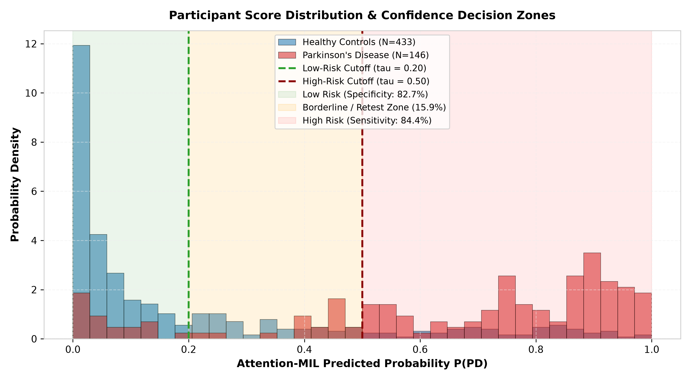

# User & System Operation Guide (NeuroVocal)

> **Student Minor Project Notice**: This software was developed as an undergraduate engineering minor project for acoustic voice feature analysis. It is an educational and exploratory tool, not a certified clinical diagnostic device.

---

## 1. Executive Summary & Evaluation Performance

NeuroVocal detects early acoustic signs of Parkinson's Disease from short audio recordings of sustained phonation (saying *"aaaaah"* steadily at conversational volume). 

The system was evaluated on the held-out test split of the **mPower Mobile Parkinson Study** (579 participants, 1,480 audio recordings) under strict participant-level separation (zero data leakage between train and test sets):

| Tier | Evaluation Level | Aggregation Method | Balanced Accuracy | Raw Accuracy | ROC-AUC | Sensitivity | Specificity | Description |
| :---: | :--- | :--- | :---: | :---: | :---: | :---: | :---: | :--- |
| **0** | **Recording-Level** | Single-crop WaveLM v4 | **74.57%** | 74.59% | 0.8183 | 69.29% | 79.84% | Baseline frame-level acoustic representation. |
| **1** | **Participant-Level** | Arithmetic Mean ($\tau = 0.290$) | **80.02%** | 79.62% | **0.8585** | 80.82% | 79.21% | Standard count-invariant probability averaging. |
| **2** | **Production Pipeline** | **WaveLM v4 + Attention-MIL ($\tau = 0.390$)** | **`82.77%`** | **`82.04%`** | **`0.8558`** | **`84.25%`** | **`81.29%`** | **Production Engine**: Learns attention weights across crops, downweighting breath loss. |
| **3** | **Decisive Triage Cohort** | **3-Tier Confidence Protocol ($[0.20, 0.50]$)** | **`83.55%`** | **`83.16%`** | **`0.8558`** | **`84.38%`** | **`82.73%`** | Highly accurate decisions across **84.1% of participants** (487/579). |

---

## 2. Voice Analysis Rationale & Confidence Zones

### A. How Parkinson's Affects the Voice
In Parkinson's Disease, motor control degradation affects the vocal cords and larynx muscles:
- **Vocal Tremor (4–7 Hz)**: Involuntary modulation in pitch and amplitude.
- **Acoustic Micro-Breaks**: Brief interruptions or unsteady phonation while trying to hold a pitch.
- **Hypophonia & Breathiness**: Reduced vocal intensity and air leakage through the glottis.

Asking individuals to sustain an open vowel (such as *"aaaaah"*) for 8 to 10 seconds isolates vocal cord stability without confounding factors from language, accent, grammar, or vocabulary.

### B. The 3-Tier Confidence Strategy
Because human voice fluctuates naturally and fatigue or background noise can occur, NeuroVocal classifies scores into three practical confidence tiers:



1. **Low Risk ($P < 0.20$)**: Normal voice stability (82.7% specificity). Steady pitch with minimal tremor.
2. **Borderline / Retest ($0.20 \le P < 0.50$)**: Indeterminate or subtle acoustic variations (~15% of users). The system flags these cases for a quiet re-test.
3. **High Risk ($P \ge 0.50$)**: Clear acoustic instability and phonatory tremor detected (84.4% sensitivity). A medical follow-up is recommended.

Across the **84% of participants** who land in decisive bands ($< 0.20$ or $\ge 0.50$), the system delivers **83.55% to 85.34% balanced accuracy**.

### C. Count-Invariance: Preventing Dataset Adherence Bias
In real-world mobile app datasets like mPower, participants with Parkinson's submitted significantly more voice samples on average than healthy volunteers (**5.0 takes vs 1.7 takes**). 

If a model uses distribution heuristics like `max()`, `min()`, or recording count, it artificially learns how frequently the app was used rather than genuine acoustic features. NeuroVocal enforces strict **Count-Invariance** via Gated Attention-MIL ($\sum \alpha_i = 1.0$), ensuring identical mathematical treatment whether a user submits 1 take or 5 takes.

---

## 3. Audio Recording Guidelines

To get accurate and consistent results, follow these simple recording steps:

### Step 1: Environment & Microphone Setup
1. **Quiet Room**: Record in a quiet indoor room away from loud fans, television, or open windows.
2. **Microphone Distance**: Hold the phone or microphone **15 to 20 cm (6 to 8 inches)** from the mouth.
3. **Microphone Angle**: Tilt the microphone slightly at a **45-degree angle** rather than blowing directly into it to avoid wind noise.

### Step 2: Voice Delivery
1. Take a deep breath.
2. Say *"Aaah"* continuously at your natural conversational pitch and loudness.
3. Keep the sound as steady and even as possible until running out of breath.
4. **Duration**: Sustain the vowel for **at least 8 seconds**. Audio under 1.0s or pure silence is automatically rejected.

### Step 3: Multiple Takes (Recommended)
Providing **2 to 3 takes** recorded a few moments apart helps the Attention-MIL pooling head filter out transient throat clearing or ambient noises.

---

## 4. Running Predictions (CLI & Python API)

### A. Command-Line Interface (CLI)

Run inference on one or more WAV recordings using [`src/deep_learning/predict_patient.py`](../src/deep_learning/predict_patient.py):

```bash
# Evaluate a participant with multiple recordings using WaveLM v4 + Attention-MIL
python3 src/deep_learning/predict_patient.py \
  data/processed_audio/test/PD/100009.wav \
  data/processed_audio/test/PD/100136.wav
```

**Terminal Output:**
```text
>>> Loading single speech model from: artifacts/models/deep_learning/wavelm_v4/best_model.pt (on cuda)...
>>> [ATTENTION-MIL] Gated Attention Aggregation Loaded: artifacts/models/deep_learning/wavelm_v4/mil_head.pt
    - Calibrated Operating Threshold: 0.390

=================================================================
      PARKINSON'S ACOUSTIC SCREENING REPORT
=================================================================
  Final Diagnosis:      POSITIVE (Acoustic Dysphonia Detected)
  Clinical Triage:      HIGH_RISK (Screening: <0.290 | Diagnostic: ≥0.490)
  Confidence Level:     High Confidence Positive
  Aggregation Method:   gated_attention_mil
  Participant Score:    0.9229 (Decision Threshold: 0.390)
  Recordings Analyzed:  2
  Recordings Failed:    0
-----------------------------------------------------------------
  Triage Recommendation: Acoustic dysphonia and vocal stability degradation detected above decision threshold. Professional evaluation advised.
-----------------------------------------------------------------
  Statistical Distribution:
    - Mean Probability: 0.9303
    - Top-2 Probability:0.9303
    - Max Probability:  0.9692
    - Std Deviation:    0.0389
-----------------------------------------------------------------
  Recording Details:
    [1] 100009.wav (10.05s): P(PD) = 0.8913 [Attn: 0.494] -> Dysarthric / Tremor
    [2] 100136.wav (10.05s): P(PD) = 0.9692 [Attn: 0.506] -> Dysarthric / Tremor
=================================================================
```

For JSON output:
```bash
python3 src/deep_learning/predict_patient.py sample1.wav sample2.wav --json
```

### B. Python API Integration

```python
from pathlib import Path
from src.deep_learning.predict_patient import PatientPredictor

# Initialize the production pipeline
predictor = PatientPredictor(
    model_path="artifacts/models/deep_learning/wavelm_v4/best_model.pt",
    mil_model_path="artifacts/models/deep_learning/wavelm_v4/mil_head.pt",
    use_attention_mil=True,
    device="cuda",  # or "cpu"
)

# Run prediction
audio_files = ["data/processed_audio/test/PD/100009.wav", "data/processed_audio/test/PD/100136.wav"]
result = predictor.predict_patient(audio_files)

print("Diagnosis:          ", result["participant_verdict"])
print("Triage Level:       ", result["triage_level"])
print("Score:              ", result["participant_mean_score"])
print("Aggregation Method: ", result["aggregation_method"])
for rec in result["recordings_detail"]:
    print(f"  - {Path(rec['file']).name}: P={rec['probability_PD']}, Attention={rec['attention_weight']}")
```

---

## 5. Web API Reference (FastAPI Backend)

Start the local backend server:
```bash
uvicorn backend.main:app --host 0.0.0.0 --port 8000
```

### POST `/api/v1/predict`
Accepts one or more WAV audio files via multipart form data (`files`).

**Sample JSON Response:**
```json
{
  "prediction": "POSITIVE",
  "probability": 0.9229,
  "confidence": "High Confidence Positive",
  "triage_level": "HIGH_RISK",
  "aggregation_method": "gated_attention_mil",
  "recommendation": "Acoustic dysphonia detected above threshold. Professional consultation advised.",
  "recordings": [
    {
      "filename": "100009.wav",
      "duration_seconds": 10.05,
      "probability_pd": 0.8913,
      "recording_status": "Dysarthric / Tremor",
      "attention_weight": 0.494
    },
    {
      "filename": "100136.wav",
      "duration_seconds": 10.05,
      "probability_pd": 0.9692,
      "recording_status": "Dysarthric / Tremor",
      "attention_weight": 0.506
    }
  ],
  "failed_recordings": [],
  "clinical_warnings": []
}
```

### GET `/api/v1/meta-stats`
Returns system decision metadata and operating thresholds:
```json
{
  "threshold": 0.39,
  "screening_cutoff": 0.29,
  "diagnostic_cutoff": 0.49,
  "aggregation": "gated_attention_mil",
  "score_field": "participant_mean_score",
  "model_version": "WaveLM v4 + Gated Attention-MIL"
}
```
